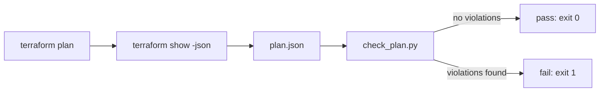

# Terraform plan policy check

## Problem

Terraform plans that break policy are usually only discovered after `apply`, when the
infrastructure is already live. Manual review of plan output doesn't scale as the number
of changes grows. A small, dependency-free checker that reads the plan JSON can catch
these issues in CI, before anything is applied.

## Flow



## Usage

```
terraform plan -out=plan.tfplan
terraform show -json plan.tfplan > plan.json
python check_plan.py plan.json --policy policy.json
```

## Rules

| Rule | Why it matters | How it is checked |
| --- | --- | --- |
| S3 buckets must have a public access block that blocks all four public settings | Public buckets are a common source of data leaks | For each `aws_s3_bucket`, look for a matching `aws_s3_bucket_public_access_block` and confirm all four block settings are `true` |
| Created or updated resources must have `Owner` and `CostCenter` tags | Untagged resources can't be attributed for ownership or billing | Check the planned `tags` map for both keys |
| `aws_instance` type must be in the allow list | Keeps instance sizes (and cost) within what's approved | Compare planned `instance_type` against `policy.json` |

The public access block resource is itself subject to the tag rule, since it is a created
resource like any other and the policy doesn't carve out exceptions by resource type.

## Status

Tested with unittest and hand-written plan fixtures only. Not run against a real
Terraform plan. The test suite has six tests; the sixth, covering an unknown bucket
name, was added beyond the five called for in the original spec.

## Known limitations

- Only planned values are checked, not provider defaults.
- Cost thresholds are not included, so Infracost is out of scope.
- Resources with unknown values after apply are skipped and reported, not treated as
  violations.
